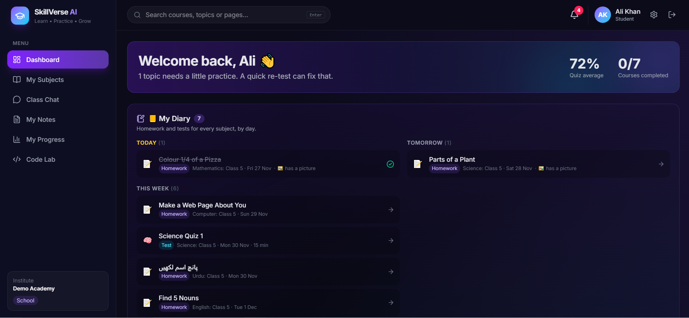
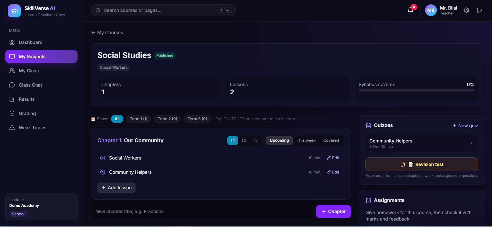
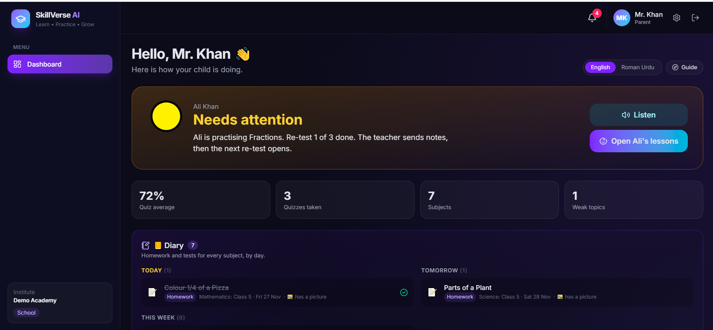
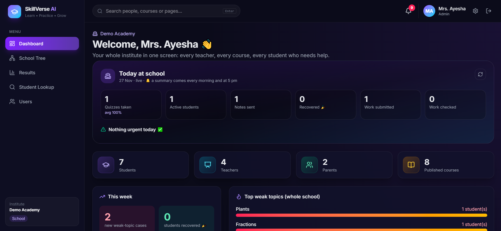
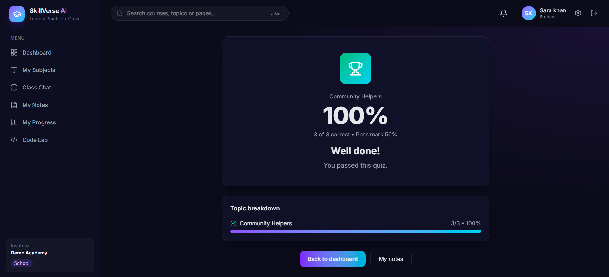
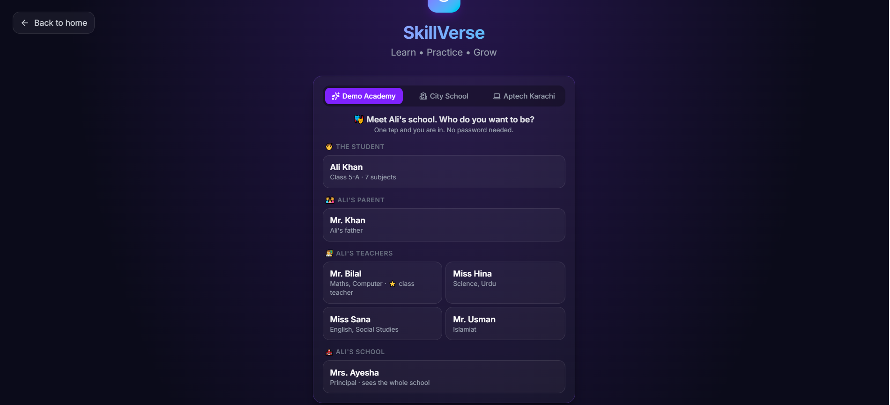

# 🎓 SkillVerse AI

**An AI-powered Learning Management System (LMS) with Smart Assessment, built as SaaS for any school or institute.**

> Other LMSs tell you a student failed. SkillVerse finds **which topic** the student is stuck on, and **keeps helping until they pass**.

🌐 **Live website:** https://skillverse-mu-snowy.vercel.app
🎭 **Try the demo:** https://skillverse-mu-snowy.vercel.app/login/demo (tap any person, no password needed)
🎬 **Video walkthrough (3 min):** [Watch here](https://youtu.be/wywHtREqYEc)

👩‍💻 Built by **Sadaf Iqbal** · Project 02: Learning Management & Smart Assessment Platform (EdTech)


📱 Scan to try the live demo on your phone.

---

## 📑 Contents
1. [The problem](#-the-problem)
2. [The Smart Intervention Loop](#-the-smart-intervention-loop)
3. [Project 02 requirements checklist](#-project-02-requirements-checklist)
4. [End-to-end demo flow](#-end-to-end-demo-flow)
5. [Features by role](#-features-by-role)
6. [Test accounts for each role](#-test-accounts-for-each-role)
7. [Screenshots](#-screenshots)
8. [Architecture](#-architecture)
9. [API endpoints](#-api-endpoints)
10. [Tech stack](#-tech-stack)
11. [Run it on your computer](#-run-it-on-your-computer)
12. [Roadmap (V3)](#-roadmap-v3)

---

## 💡 The problem

A teacher gives 100% effort, and a student still scores 0. In most schools this is found **after the result card**, when it is too late to fix. Parents get long English reports that don't say what to do at home, and teachers can't track every child in every subject.

**SkillVerse finds the problem on day 1, not at the PTM.**

---

## 🔁 The Smart Intervention Loop

Like a doctor: **measure, find the cause, treat, and check again.**

| Step | What happens |
|---|---|
| 1. 📝 Quiz | Every question has a topic, so every topic is scored separately |
| 2. 🌱 Weak topic found | A short **re-test** with new questions opens automatically, with AI revision notes |
| 3. 📄 Still weak | The **teacher is alerted** and sends notes **once**; every weak student gets them |
| 4. 🔁 Re-test 2 and 3 | New questions each round |
| 5. 🙋 Failed all 3 | No more tests. **1-on-1 help**: the teacher, **class teacher**, **parents** and **principal** are told |
| 6. 🎉 Passed in any round | The topic is marked **Recovered**, and the parent sees it |

---

## ✅ Project 02 requirements checklist

**Mandatory product modules**

| Module | Status | Where |
|---|---|---|
| Course creation | ✅ | Teacher → My Subjects → New course |
| Modules and lessons | ✅ | Course Builder (chapters + lessons, ✨ AI drafts) |
| Enrollment | ✅ | Student → My Subjects → Explore → Enroll |
| Quizzes with automatic grading | ✅ | Graded on the server, per-topic scores |
| Assignments and submissions | ✅ | Teacher → Grading; student submits text, photo or PDF |
| Student progress | ✅ | Student → My Progress (topic mastery, term marks /25) |
| Instructor dashboard | ✅ | Heatmap, early warning, "your turn this week", grading |
| Completion certificate preview | ✅ | Student → course → Certificate (after all lessons) |

**Required engineering quality**

| Rule | How SkillVerse does it |
|---|---|
| Only enrolled students access protected lessons | The lesson API checks the `Enrollment` before sending a lesson |
| Quiz answers are graded server-side | `correctIndex` is `select: false` in the `Question` model, so the right answer never reaches the browser; the server checks every answer |
| A student sees only their own results | Every progress and attempt query uses the logged-in `userId`; parents only see their own linked child |

**Bonus (innovation and AI)**

| Bonus | Status |
|---|---|
| AI tutor restricted to course material | ✅ Class Chat: AI answers from the course, the teacher reviews the answer |
| Personalized study suggestions | ✅ Weak topic → AI revision notes → re-test, plus a Mistake Notebook |
| Coding sandbox | ✅ Code Lab (HTML, CSS, JavaScript, live preview) |

---

## 🎬 End-to-end demo flow

The required flow, step by step (also shown in the video):

1. **Teacher publishes a course:** `teacher@demo.com` → My Subjects → **New course** → add a chapter and a lesson → add a quiz (✨ AI can draft questions) → **Publish**
2. **Student enrolls and studies:** open `/register/demo` → create a student account → My Subjects → **Explore** → **Enroll** → open the lesson → **Mark complete**
3. **Student submits the quiz:** open the quiz → answer → **Submit**
4. **Score and progress update automatically:** the score shows at once, and **My Progress** and the teacher's **Results** update; when all lessons are done the **certificate** opens

---

## ✨ Features by role

### 🧒 Student
- 📒 **Diary:** every subject's homework and tests by day (today, tomorrow, this week)
- Lessons with explanation, key points, examples and "check yourself" questions
- 📖 **Urdu lessons and quizzes** right to left, with 🔊 listen (where the device has an Urdu voice)
- Quizzes with a timer, per-topic results and a **Mistake Notebook**
- Automatic **re-tests** for weak topics
- 💻 **Code Lab**: HTML, CSS and JavaScript with a live result
- 💬 **Class Chat + Ask Teacher**: AI answers right away, the teacher checks it
- 📓 **My Notes**: write your own notes, or let AI make them
- 📷 Submit homework as text, a photo or a PDF
- 📊 **Term marks out of 25** (quizzes 15 + homework 10; re-tests are practice and never reduce marks)
- 🏆 Certificate when a course is complete

### 👩‍🏫 Teacher
- Build courses: chapters, lessons, quizzes (✨ AI drafts lessons and questions; the teacher approves each one)
- 📅 Tag chapters as **Term 1 / 2 / 3**, and mark them Upcoming, This week or Covered
- 📝 **Revision Test** from chosen chapters
- 🖼️ Assignments with a picture (own photo or ✨ AI diagram), great for Grade 1 to 5
- Grade work with marks and feedback; 🗑️ delete an assignment only if nobody has submitted
- **Weak Topics** page and a class topic heatmap
- 🔮 **Early Warning**: falling scores, no activity, missing homework, a test coming soon → send one reminder a day to the student, parents and principal
- ⚖️ **Your turn this week** (Assessment Planner)
- 👩‍🏫 **My Class** (class teacher): the whole class plan, subjects, timetable and latest work
- 📊 Results and gradebook with term marks

### 👨‍👩‍👦 Parent
- 🟢🟡🔴 One-look status of the child, with the reason
- 🔊 **Listen** in English or Roman Urdu
- 📒 The child's diary, and subject cards with tests, homework, results, notes and term marks
- 🧒 **Child mode**: open the child's account to help submit homework
- See the child's exact quiz answers

### 🏫 Principal / Admin
- 🌅 **Daily summary** every morning and at 5 pm, and a live **Today at school** card
- 🌳 **School Tree**: every class, class teacher, subject, teacher, timetable and who did what
- ⚖️ **Assessment Planner**: 2 subjects a week in turns, the plan's ✅/⏳ checklist, "plan followed"
- 🔴 Alerts when a student needs 1-on-1 help, and early-warning reminders
- Student lookup with a full activity timeline, results, users and password reset

### 🏢 SaaS: one platform, every institute
- Any **school, college, university, computer institute or online academy** can register itself in 2 minutes
- Each institute's data is **separate and private** (every record carries its institute's ID)
- Labels fit the institute: Class / Section / Batch, Subject / Course
- 🔒 **Demo lock:** in the public Demo Academy, password changes and deletes are locked so visitors can't break the demo; private institutes can't be joined without the school adding you
- 👥 **Who adds whom:**

| | Demo Academy (public) | Private institute (e.g. a real school) |
|---|---|---|
| Student account | Student signs up with code `demo` | Principal creates it (sign-up is closed) |
| Enroll in a course | Student enrolls in any published course | Same: student enrolls in their own institute's courses |
| Teacher / Parent account | Created by the principal | Created by the principal |
| Put a student in a class (e.g. 5-A) | Principal | Principal |

---

## 🎭 Test accounts for each role

**Demo Academy**, institute code `demo`, password `demo123` for everyone. On `/login/demo` you can just tap a person.

| Role | Name | Email |
|---|---|---|
| Principal (Admin) | Mrs. Ayesha | principal@demo.com |
| Teacher (Maths, Computer, class teacher 5-A) | Mr. Bilal | teacher@demo.com |
| Teacher (Science, Urdu) | Miss Hina | science@demo.com |
| Teacher (English, Social Studies) | Miss Sana | english@demo.com |
| Teacher (Islamiat) | Mr. Usman | islamiat@demo.com |
| Student (weak in Fractions) | Ali Khan | student@demo.com |
| Student (re-test ready) | Omar Shah | omar@demo.com |
| Student (top) | Sara Ahmed | sara@demo.com |
| Student (early warning) | Fatima Noor | fatima@demo.com |
| Parent of Ali | Mr. Khan | parent@demo.com |
| Parent of Fatima | Mrs. Noor | fatima.parent@demo.com |

To reset the demo: `cd server` → `node seed/addDemoAcademy.js` (this only touches Demo Academy).

---

## 🖼️ Screenshots

| Student | Teacher |
|---|---|
|  |  |

| Parent | Principal |
|---|---|
|  |  |

| Quiz result | Login: Meet Ali's school |
|---|---|
|  |  |

---

## 🏗️ Architecture

```
  Browser (React + Vite + Tailwind)
        │  HTTPS + JWT (Authorization: Bearer)
        ▼
  Express API on Vercel ──► Google Gemini (AI lessons, questions, notes, chat, diagrams)
        │
        │  middleware: helmet · CORS · rate limits · DB connect · demo lock · protect (JWT) · authorize (role)
        │  routes → controllers → services (intervention loop, early warning, term marks, daily summary)
        ▼
  MongoDB Atlas (Mongoose) · every document has organizationId (multi-tenant SaaS)
```

- **Two Vercel projects:** `client` (website) and `server` (API). Every `git push` deploys both.
- **Multi-tenant:** the JWT carries `{ userId, role, organizationId }`; every query filters by `organizationId`.
- **Roles:** `student`, `instructor`, `orgadmin`, `parent`.
- **Collections:** User, Organization, Course, Module, Lesson, Enrollment, Quiz, Question, Attempt, Assignment, Submission, Intervention, Note, Notification, ChatMessage, MyNote, SchoolClass, Reminder.

---

## 🔌 API endpoints

All under `/api`. 🔒 = needs login.

**Auth and institutes**
| Method | Endpoint | What it does |
|---|---|---|
| POST | `/organizations/register` | Register a new institute (and its admin) |
| GET | `/organizations/check/:slug` | Is this institute code free? |
| POST | `/auth/register` | Student sign-up with an institute code |
| POST | `/auth/login` | Log in, get a JWT |
| GET | `/auth/me` 🔒 | The logged-in user |

**Courses, lessons, enrollment**
| Method | Endpoint | What it does |
|---|---|---|
| POST | `/courses` 🔒 | Create a course (teacher) |
| GET | `/courses` 🔒 | List courses |
| GET | `/courses/:id` 🔒 | One course with chapters and lessons |
| POST | `/courses/:id/modules` 🔒 | Add a chapter |
| PATCH | `/courses/:id/modules/:moduleId` 🔒 | Edit a chapter (term, status) |
| POST | `/courses/:id/modules/:moduleId/lessons` 🔒 | Add a lesson |
| PATCH | `/courses/:id/publish` 🔒 | Publish a course |
| POST | `/courses/:id/enroll` 🔒 | Enroll (student) |
| GET | `/courses/:id/certificate` 🔒 | Completion certificate |
| POST | `/lessons/draft` 🔒 | ✨ AI lesson draft |
| GET | `/lessons/:id` 🔒 | A lesson (enrolled students only) |
| POST | `/lessons/:id/complete` 🔒 | Mark a lesson done |

**Quizzes and attempts**
| Method | Endpoint | What it does |
|---|---|---|
| POST | `/quizzes` 🔒 | Create a quiz |
| GET | `/quizzes/:id/questions` 🔒 | Question bank (teacher) |
| POST | `/quizzes/:id/questions` 🔒 | Add a question |
| POST | `/quizzes/:id/generate` 🔒 | ✨ AI questions |
| PATCH | `/quizzes/:id` 🔒 | Settings and test date |
| POST | `/quizzes/:id/attempts` 🔒 | Start a quiz attempt |
| POST | `/attempts/:id/submit` 🔒 | Submit; graded on the server |
| GET | `/attempts/me` 🔒 | My attempts |
| GET | `/students/me/progress` 🔒 | My progress, topics, term marks |

**Assignments**
| Method | Endpoint | What it does |
|---|---|---|
| POST | `/assignments` 🔒 | Give homework |
| GET | `/assignments` 🔒 | List homework |
| DELETE | `/assignments/:id` 🔒 | Delete (only if nobody submitted) |
| POST | `/assignments/:id/submissions` 🔒 | Submit work (student) |
| GET | `/assignments/:id/submissions` 🔒 | See submissions (teacher) |
| PATCH | `/submissions/:id/grade` 🔒 | Grade with marks and feedback |

**Smart assessment, early warning, planner**
| Method | Endpoint | What it does |
|---|---|---|
| GET | `/interventions` 🔒 | Weak topics (teacher) |
| POST | `/interventions/notes` 🔒 | Send notes to weak students |
| POST | `/interventions/:id/retest` 🔒 | Start a re-test |
| GET | `/dashboard/early-warning` 🔒 | Students at risk |
| POST | `/dashboard/early-warning/remind` 🔒 | One reminder a day |
| GET | `/classes` 🔒 | School Tree (principal) |
| GET | `/classes/mine` 🔒 | My Class + My Timetable |
| GET | `/classes/turns` 🔒 | "Your turn this week" |
| GET | `/results/course/:courseId` 🔒 | Gradebook with term marks |

**Parents, diary, notifications, chat**
| Method | Endpoint | What it does |
|---|---|---|
| GET | `/parents/children/:id/overview` 🔒 | Parent dashboard (own child only) |
| GET | `/diary/me` 🔒 | My diary |
| GET | `/diary/child/:id` 🔒 | My child's diary |
| GET | `/notifications/me` 🔒 | My bell |
| GET | `/chat/course/:courseId` 🔒 | Class chat |
| POST | `/chat/course/:courseId` 🔒 | Ask (AI answers, teacher reviews) |

---

## 🛠️ Tech stack

| Part | Tools |
|---|---|
| Frontend | React 19, Vite, Tailwind CSS v4, React Router 7, Recharts, Lucide icons |
| Backend | Node.js, Express 5, Mongoose 9 |
| Database | MongoDB Atlas |
| AI | Google Gemini (lessons, questions, notes, chat answers, diagrams) |
| Security | JWT login, bcrypt password hashing, Helmet, rate limits, CORS whitelist, demo lock |
| Hosting | Vercel (website + API), daily cron for the principal summary |

---

## 📁 Folder structure

```
skillverse/
├── client/          React website
│   └── src/
│       ├── pages/       student, teacher, admin, parent pages
│       ├── components/  shared UI (Diary, Code Lab, Quiz Player, Toast...)
│       ├── api/         axios + JWT
│       └── context/     login state
└── server/          Express API
    ├── models/          MongoDB schemas
    ├── controllers/     the logic for each feature
    ├── routes/          API endpoints
    ├── middleware/      login, roles, demo lock
    ├── services/        AI, intervention loop, early warning, term marks, daily summary
    └── seed/            demo data scripts
```

---

## 🚀 Run it on your computer

**1. Server**
```bash
cd server
npm install
```
Create `server/.env`:
```
MONGO_URI=your-mongodb-connection-string
JWT_SECRET=any-long-random-text
GEMINI_API_KEY=your-gemini-key
GEMINI_MODEL=gemini-2.5-flash
```
Then:
```bash
npm run dev
```

**2. Website**
```bash
cd client
npm install
npm run dev
```
Open http://localhost:5173

**3. Demo data**
```bash
cd server
node seed/addDemoAcademy.js
```

> ⚠️ Never upload your `.env` file to GitHub.

---

## 🗺️ Roadmap (V3)

- 📄 Full report card: class work split into First and Second term, plus the 75-mark final exam
- 📲 Automatic WhatsApp and SMS alerts for parents
- 📊 Weekly PDF report for the principal (every class, teacher and student)
- 🔄 Change a subject's teacher, with history kept
- 📥 Import students from Excel, and invite links
- ✅ Principal approval for new sign-ups and email verification
- 🔊 Server-side Urdu voice on every device, and 🎤 Urdu voice input
- 🎨 Each institute's own logo and name
- 📱 Mobile app, 💳 subscription plans, 🖥️ self-hosted version

---

## 🙏 Thank you

SkillVerse was built so that **no student is left behind quietly**.

Made with ❤️ by **Sadaf Iqbal**